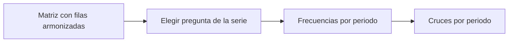

# Comparativos

> Frecuencias y cruces de una serie armonizada: la misma pregunta medida en varias olas, llevada a una escala común.

## Objetivo

Comparar mediciones de distintos periodos sin mezclar códigos: cada base aporta su variable según la matriz de equivalencias y su mapa de armonización.

## Antes de empezar

- Declarar en Carga › Equivalencias las filas armonizadas y los periodos de la serie (dos o más).
- Sin filas armonizadas la pestaña responde que falta la matriz (`E_ARMONIZADA_SIN_MATRIZ`).

## Mapa de la pantalla

