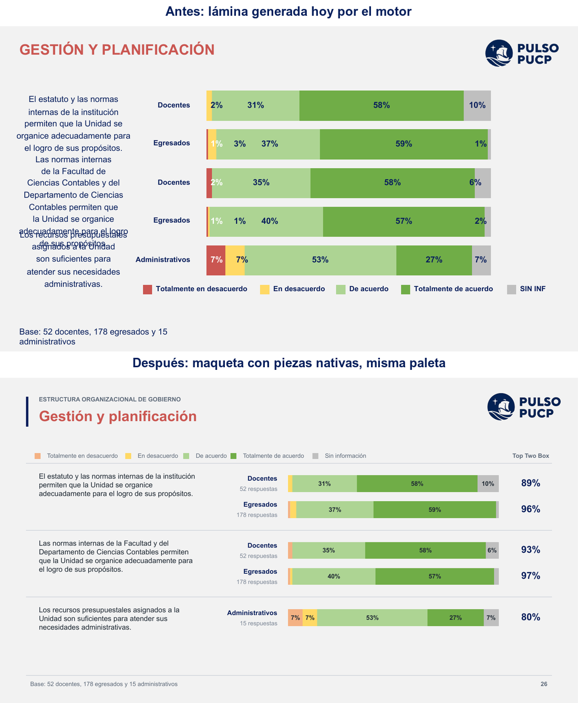
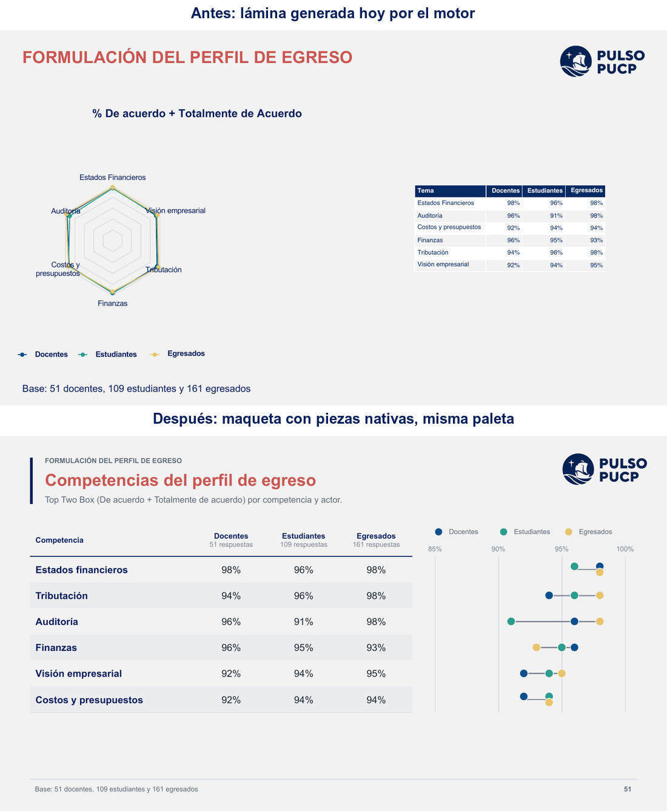
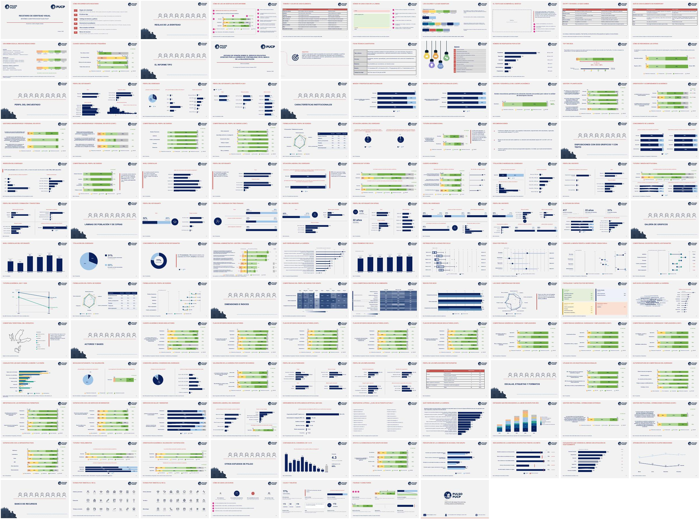
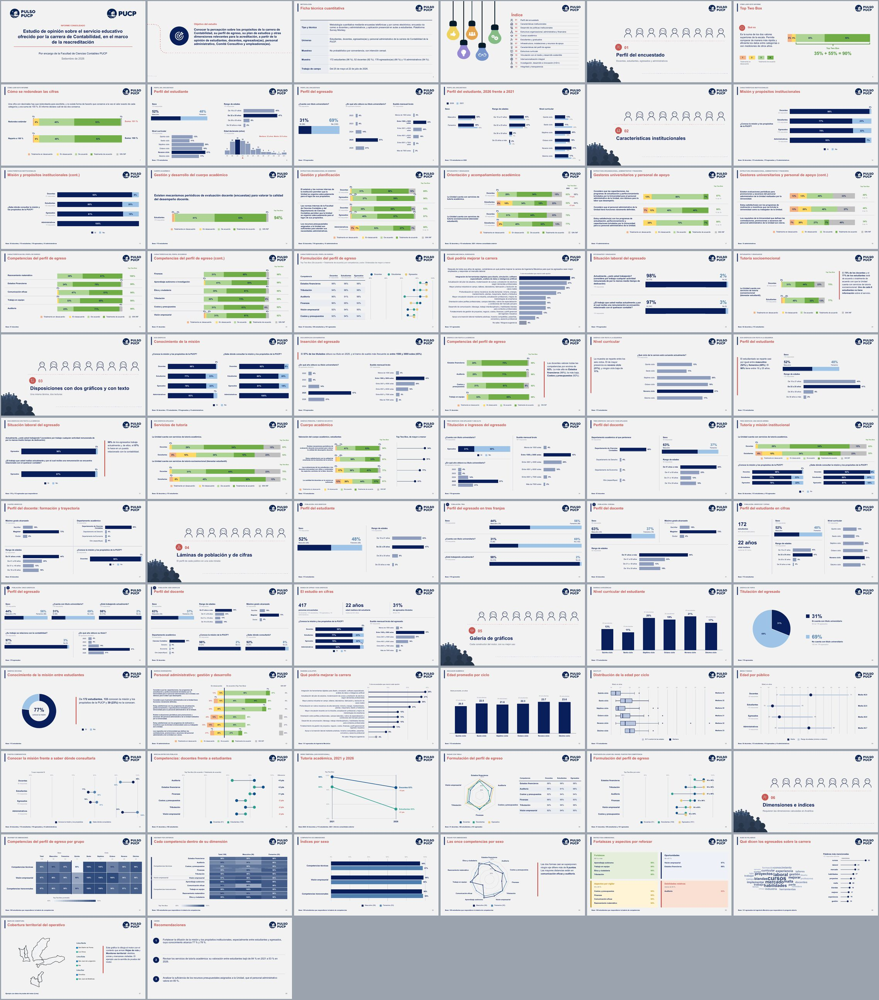

# Checklist: diagnóstico del motor de PPT (2026-10-06)

Todos los entregables de este trabajo están ordenados en [`motor-ppt-2026-10-06/`](motor-ppt-2026-10-06/README.md); empieza por su README.

Pedido: entender por qué el motor de PPT no llega al nivel de las presentaciones
de capacitación de Ser Adolescente 2026 y proponer un plan para cerrar la brecha.
**Diagnóstico y plan, sin tocar el motor.** Sólo Gonzalo da por terminado este
checklist.

## Cómo se obtuvo la evidencia

- **Mazo medido**: plan aprobado de `acrconta_mazo` (ADR 0043), 67 láminas de
  plan que salen en 71 por la partición «(CONT.)». Se generó en proceso, por el
  mismo camino que `POST /api/graficos/ppt` y sin levantar servidor:
  [`generar_mazo.R`](motor-ppt-2026-10-06/herramientas/generar_mazo.R).
  Pesa 948 KB, en línea con el mazo sano de las trampas conocidas.
- **Render**: PowerPoint real (`api/scripts/ppt_a_pdf_powerpoint.sh`) y
  LibreOffice, ambos a PNG con `pdftoppm`. Se miraron las 71 láminas en hojas de
  contacto y las típicas en alta resolución.
- **XML**: [`xml_audit.py`](motor-ppt-2026-10-06/herramientas/xml_audit.py)
  y el prototipo de gate
  [`detector_encimado.py`](motor-ppt-2026-10-06/herramientas/detector_encimado.py).
- **Verificador existente**: `verificar_mazo()` sobre el mismo archivo.
- **Referencia**: `Lima.pptx` de la capacitación, exportado por PowerPoint.
- Los PNG de trabajo quedan en `tmp/motor-ppt-diag-2026-10-06/` (no versionado).

Tipos de defecto: **diseño** (falta un sistema de piezas), **adaptación** (el
contenido real rompe un diseño fijo) y **verificación** (nadie lo mira).

## Indicaciones recibidas en la sesión

| # | Indicación | Dónde vive | Estado |
|---|---|---|---|
| I1 | Diagnóstico y plan, no implementación; no tocar el motor | Este documento | ☑ Cumplida: cero cambios en `api/R/` |
| I2 | Generar un mazo real con un proyecto de referencia y pasarlo a PNG | `generar_mazo.R`, `tmp/` | ☑ |
| I3 | Contrastar lámina por lámina con los cuatro principios | Tabla de hallazgos | ☑ |
| I4 | Revisar el XML por los tres defectos de pptxgenjs y lo que LibreOffice no ve | H19 a H21 | ☑ |
| I5 | Plan por prioridad con costo y beneficio (kit, adaptación, gate, officer o pptxgenjs) | Sección Plan | ☑ Propuesto |
| I6 | Antes y después de una lámina de barras y una de tabla | Sección Antes y después | ☑ |
| I7 | Tener en cuenta que son informes cuantitativos: gráficos elegantes e información rigurosa | Criterio transversal; H4, H9, H15 | ☑ Aplicado |
| I8 | Libertad para mejorar cómo se dice la n y bajar el contraste del fondo | Maquetas, vuelta 3 | ☑ |
| I9 | Si se cambia un tipo de gráfico, proponer las alternativas por caso, con censo de qué se usa, qué se evalúa y cómo la UI rodea las limitaciones | Secciones Censo y Tipos de gráfico | ☑ 6 estudios, 365 gráficos, 64 mazos entregados |
| I10 | Respetar la paleta de colores, que ya está validada | Maquetas y recetario | ☑ Extremo negativo de la escala en naranja `F4B183`; `CA5651` sólo en títulos (corregido tras observación de Gonzalo) |
| I11 | ¿Usar JavaScript, como el generador de Ser Adolescente? | Plan d | ☑ Evaluado: no para generar; sí para la vista previa desde una especificación común |
| I12 | No agregar notas que el original no tiene (base chica, notas de lectura, subtítulo con la escala) ni renombrar el Top Two Box | Maquetas, vueltas 5 y 6; kit y reglas | ☑ Retiradas del PPT, del kit y de las reglas |
| I14 | El subtítulo «Grado de acuerdo… Escala de 4 puntos» tampoco es necesario | Maqueta y kit | ☑ Retirado; subtítulo sólo donde el original trae encabezado |
| I15 | La propuesta debe ser un PPT de muestra con **todos** los gráficos que generamos, remasterizados: agrupadas para selección múltiple, apiladas para select_one con los 1 % visibles y los demás importantes | Recetario remasterizado | ☑ Superado por I18 a I20: 25 láminas en dos versiones |
| I16 | Usar también la acreditación de Ingeniería, que tiene selecciones múltiples | Recetario, lámina de selección múltiple | ☑ «Qué podría mejorar la carrera», 11 opciones, 131 egresados |
| I17 | Cuidado con el punto medio («·») como separador | Mazo de muestra (láminas 5 y 11); validador c1 | ☑ Reemplazado por puntuación normal; el validador lo marca |
| I18 | La portada no debe romper con las anteriores; revisar lo que la app ya sabe hacer; el PPT es un recetario de todas las situaciones, mejor que el que ya había con guías | Sección Recetario remasterizado | ☑ Portada sobre el layout de la plantilla; 25 láminas; versión con guías y cotas en cm |
| I19 | Títulos en tipo oración; antetítulo sí, si suma a lo moderno; alcance completo con guías | Versión moderna | ☑ |
| I20 | Dos versiones: una fiel al estilo entregado y otra moderna que proponga cambios de gráfico sustentados en lectura profunda sobre representación correcta de datos | Recetario; [guía de evidencia](motor-ppt-2026-10-06/2-guia-visualizacion-encuestas.md) | ☑ Guía de 7.300 palabras con fuentes y nivel de respaldo por recomendación |
| I21 | La moderna aún hace peor muchas cosas que la clásica | Recetario, vuelta de paridad (M1 a M10) | ◐ Diez regresiones corregidas; faltan las que Gonzalo identifique |
| I22 | Objetivo único con ícono de diana y flecha de una librería; mejora completa de la moderna (la portada fiel era mejor: título azul, mejor centrado y uso del espacio); seguir con las tres débiles | Recetario: objetivo, portada, Top Two Box, competencias | ☑ Íconos de Lucide, la librería de la app; diana con flecha en el trazo de Lucide |
| I23 | El recetario no debe incluir lo que Prosecnur no hace (tarjetas con texto, resumen ejecutivo): presentarlo como propuesta muestra que no se conocía el producto | Recetario; tabla de correspondencia con el motor | ☑ Retiradas tarjetas, resumen ejecutivo y contraportada (sin constructor); agregada `p_slide_redondeo`; cada lámina mapeada a su constructor |
| I25 | PPT con cada constructor y cada lámina; ordenar la carpeta; no toda lámina admite todo gráfico (el radar va con su tabla; unos se combinan y otros no) | Catálogo PPT, sección D del Word, carpeta `motor-ppt-2026-10-06/` | ◐ Matriz por código hecha; mazo y prueba renderizando en curso |
| I24 | Los comparativos entre años no son habituales; Word editable con todos los tipos de gráfico y de lámina para que el recetario moderno cubra todo el abanico | [`motor-ppt-2026-10-06/3-catalogo/catalogo-laminas-y-graficos.docx`](motor-ppt-2026-10-06/3-catalogo/catalogo-laminas-y-graficos.docx) | ◐ Entregado; Gonzalo completa las columnas «¿Entra?» y «Variante o comentario» |
| I26 | Loop indefinido: que el recetario moderno cubra todos los gráficos y láminas, más sofisticado, profesional y con buen uso del espacio | Recetario, 68 láminas; `medir_espacio.py` | ☑ loop cerrado por Gonzalo el 2026-10-07 («ya creo que con ellos podemos ir cerrando el reloj y viendo lo pendiente»). Antes: ◐ Loop abierto. Cobertura 32/32 láminas y 24/24 gráficos; 0 láminas con franja vacía > 1 in; gate del XML en verde |
| I27 | Prueba final: en Drive 2024, 2025 y 2026, buscar todos los proyectos de acreditación, ver sus informes PPT y Word, extraer sus bases y comprobar si el motor es robusto para cada carrera o facultad y sus pedidos (p. ej. Ingeniería: todos los números y «los otros» en lámina aparte) | Drive (solo lectura); inventario en el scratchpad; pruebas sobre el motor sin tocar `api/` | ◐ Bases locales en `~/Documents/Pulso/EjemplosAcreditas` (9 proyectos 2024-2026, sólo Contabilidad con `.pulso`). Ingeniería (9 especialidades, `.pulso` local): el motor corre sin error en las 9 (30 a 32 láminas); contra los entregados de Mecánica, Civil e Industrial salen H45 a H55. Psicología 2024 reconstruida por la ruta de la app (editor + importador .sav): cifras exactas, pero escala con otra redacción rompe TTB, paleta y comparación entre actores (H57 a H61). Contabilidad: 70 láminas sin error (H72) |
| I28 | Recetario v2 «identidad visual de acreditación», generalista, fiel afinada y moderna mejorada, con todos los escenarios de gráficos y láminas; datos con forma real y porcentajes ficticios; reemplaza al v1 | `4-recetario/`, `herramientas/recetario_m0.R` y `recetario_m4.R`, catálogo de escenarios en el scratchpad | ◐ 106 láminas moderna y 108 fiel publicadas (portadillas 00 Reglas y 08 Escalas, etiquetas y composición; contraportada con el contacto medido en los entregados) (gate del XML en verde, sin formas fuera de la lámina): sección 00 de reglas (4) y sección 07 de escenarios (tanda 1: 12; tanda 2: 17 más); sigue ampliando |
| I29 | Láminas iniciales con las reglas de tamaño, peso, color y posición de cada elemento, márgenes y cómo conviven texto y gráficos, tomadas de los informes finales | `recetario_m0.R`; medición con `herramientas/medir_estilo.py` (2.725 cuadros de texto de 6 informes) | ☑ 4 láminas: tipografía por elemento, retícula y márgenes, paleta y uso, texto junto a gráficos |
| I30 | El recetario debe ser amplio y extenso: todas las situaciones que se ven en los proyectos | catálogo de escenarios y secciones del recetario | ◐ tanda 2 publicada: escalas que llegan y cómo se leen igual, utilidad, competencia e importancia, egresados frente a empleadores, Sí/No con «No sabe», inserción laboral, perfil con base chica, partición con 6 actores, etiquetas largas y cortas, láminas mixtas |
| I31 | Etiquetas cortas y etiquetas muy largas | `recetario_m5.R`: láminas «Etiquetas largas» (ítems de 220 a 260 caracteres) y «Etiquetas cortas» | ☑ |
| I32 | Lámina mixta: una pregunta con su escala y sus actores arriba y otra con otros actores u otra escala abajo | `recetario_m5.R`: `bloque_mixto()` (motor: `p_barras_multiapiladas(modo = "multilista")`), dos láminas | ☑ |
| I33 | Forma moderna de mostrar que quienes responden una pregunta son los únicos que responden la siguiente (al costado o abajo) | `recetario_piezas.R`: `zoom_conector()` (desglose conectado: cuña translúcida del segmento «Sí» a su subpregunta); `recetario_m4.R`: «Movilidad» (abajo) e «Ingresos» (al costado, con «Sí» pegado al desglose). La fiel conserva torta y paneles | ☑ moderna; PROPUESTA para el motor |
| I34 | «los porcentajes aun no chocan del todo»: las cifras chicas encima de la barra tocaban la barra de la fila de arriba | `recetario.R` (`bloque_likert`, `tiene_peq()`) y `recetario_piezas.R` (`likert_panel`): si una fila tiene cifras afuera y el aire es menor de 0,36 in, la barra adelgaza (mínimo 0,24 in); la letra no encoge, el 1 % no se omite y no se agregan láminas. Verificado a 150 dpi | ☑ |
| I35 | «¿qué pasa si en una barra apilada hay un 1 %, 2 % y 3 % uno al lado del otro?» | `barra_apilada()` en `recetario.R`: las cifras que no caben van encima con guía y se separan 0,46 in; si el grupo pasa el final de la barra (chicas al final), se corre a la izquierda y no sale de la barra. Lámina «Cifras chicas seguidas» con 4 casos extremos (inicio, final, dos extremos, todas chicas salvo una) | ☑ verificado a 75 dpi |
| I36 | «y el slide de redondeo de cifras» + repaso de láminas de lectura | `recetario.R`: redondeo moderno como matriz exacta (valor exacto 0.56% … , redondeo estándar suma 101%, reparto a 100% con la celda que cambia en coral); fiel conserva las barras del motor (sin espacio antes de %). Ficha técnica moderna en filas con ícono y muestra por actor (cifra y tasa); Top Two Box moderno con barra grande, llave y columna «90%» como en los gráficos | ☑ |
| I37 | Revisión de choques en las primeras filas y gate de encimados | `herramientas/detector_encimado.py` v2: compara la TINTA estimada (tamaño, negrita, alineación y anclaje) y no la caja; de 40 láminas con falsos positivos a 15 candidatos, revisados a 100-150 dpi: un choque real (cifras de los anillos del radar sobre el rótulo del eje superior), corregido en los TRES radares (`recetario.R` fiel, `recetario_m3c.R` y `recetario_m3d.R` de 11 ejes): cifras entre los dos primeros ejes, con fondo y por encima de las series. Tras el arreglo: moderna 14 y fiel 4 láminas con candidatos, todos falsos positivos revisados. Los demás son la nube de palabras y estimaciones holgadas | ☑ |
| I38 | A futuro: comparar los gráficos de los informes en Word de todos los proyectos (no todos lo tienen) con el motor de Word (`reporte_word_plan`) y ver si hace falta remasterizarlos | Inventario inicial (informe Word final más reciente): Psicología 54 gráficos nativos; Escultura 120 nativos; Educación Secundaria CCSS 98 nativos; Comunicación para el Desarrollo 88 imágenes; Derecho 121 imágenes; AMDT 91 imágenes y 5 nativos; Geografía, Ingeniería y FG Arte y Diseño sin Word; Contabilidad por ubicar (la búsqueda tomó un informe del Consejo Consultivo 2021). Los nativos de 2024-2025 traen sus valores en el XML: comparación exacta posible | ☐ futuro, sin empezar |
| I39 | «¿aquí no le falta la llave?» (Inserción del egresado) | No: la llave o el desglose conectado sólo van cuando el filtro y su subpregunta están en la misma lámina; aquí el filtro («¿Cuenta con título?») vive en otra y el año declara su base propia. Sí había un error: el pie decía «Base: 178 egresados» aunque los gráficos usan 56 y 167. Corregido en las tres láminas con ese patrón (`recetario_m2.R`, `recetario_m2b.R`, `recetario.R` perfil del egresado): el pie nombra cada base. Barrido automático de todo el mazo: la regla queda en dos casos. Base FILTRADA (la pregunta sólo se hace a una parte): el pie lo dice (también «Misión (cont.)»: «Dónde consultarla: sólo quienes conocen la misión»). FALTA DE RESPUESTA (176 o 172 de 178): basta el «N respuestas» de cada gráfico con el total del actor al pie, como en los informes entregados | ☑ |
| I40 | Orden lógico y coherente del recetario | Recorrido en cinco partes con portada del recetario y mapa: I Reglas (tipografía, retícula, paleta, texto, escalas que llegan, cifras chicas), II El informe tipo (de la portada a las recomendaciones, en el orden de entrega), III Catálogo (III.1 a III.4), IV Escenarios de acreditación (IV.1 Actores y bases, IV.2 Escalas, etiquetas y formatos, con antetítulos que nombran el escenario), V Otros estudios. La lámina de Ingeniería salió del informe tipo de Contabilidad. `recetario.R`, `recetario_m0b.R`, `recetario_m1b.R`, `recetario_m4.R`, `recetario_m5.R` | ☑ |
| I41 | Mostrar la utilidad de la identidad en otros estudios de PULSO | `recetario_m6.R`, Parte V, 6 láminas con forma real y cifras ficticias: opinión pública (escala de 1 a 10 con NS/NR al final; cruce por grupo de edad), estudio cuasi-experimental (intervención frente a comparación), monitoreo posdistribución (indicadores frente a su meta, PROPUESTA), encuesta en aulas (prevalencia con casos por facultad y bases chicas) y estudio por olas (serie temporal) | ☑ |
| I42 | «que el recorrido por el ppt y el word sea elegante, formal y bien pensado» → corregido por Gonzalo: «en word los gráficos van con un formato especial para que se vean bien: sin fondo, con texto encima como título y texto abajo para los públicos». La guía en Word que hice NO era lo pedido y se borró. Lo pedido: recetario en Word, fiel y moderno, con el formato de gráfico de los Word entregados | `4-recetario/recetario-word-fiel.docx` y `recetario-word-moderna.docx` (`herramientas/recetario_word.R` + `recetario_word_graficos.R`), 31 y 38 páginas A4 y 62 gráficos cada uno; la galería numerada (3.1 a 3.8) y cada tipo con «Cuándo se usa», con ficha técnica y número de respuestas, cifras chicas seguidas, redondeo, perfil de empleadores, desglose de un actor, perfil de autoridades en tabla y comparativo 2026 frente a 2021 (ampliado por pedido de Gonzalo: «debería ser más extenso»), en las cinco partes del PPT. Formato medido en los Word entregados: título «Gráfico N.º X: pregunta» como párrafo arriba (9 pt negrita cursiva navy), imagen sin fondo de 6,3 in, leyenda y «N = … Fuente: PULSO PUCP 2026.» al pie dentro de la imagen, Top Two Box arriba a la derecha, párrafo 11 pt justificado, cabecera PUCP / PULSO. Fiel: azules y tortas de los entregados; moderna: destacado, dicotomía, dumbbell | ☑ segunda versión: comparada con el Word de Derecho (la fiel pasó a su escala: barras más gruesas y juntas, letra de 7,5 a 8,5 pt, logo simple de PULSO); etiquetas largas sin cortes (margen calculado por la línea más larga y alto de fila por número de líneas) |
| I43 | «Las reglas de gráficos en Word y en PPT son algo diferentes y además ambas deben estar mucho más claras para que cualquier público pueda entenderlo» | `recetario_m0.R`, `recetario_m0b.R` (PPT, Parte I) y sección 1 de `recetario_word.R` | ☑ primera versión: las dos abren con un gráfico de ejemplo explicado parte por parte; reglas en lenguaje llano sin códigos ni coordenadas (los códigos de color quedan al pie para quien diseña); cada formato con sus propias reglas y una tabla de lo que cambia frente al otro |
| I44 | «Que en Word se vea mucho mucho mejor en la versión remasterizada» | `recetario_word.R` (rama `MOD`) | ☑ primera versión: portada en bloque navy, contenido con números grandes, capítulos que abren con número coral, rótulo «GRÁFICO n» + pregunta a la izquierda, lectura con filete coral y cifras en negrita unida al gráfico (no se separan entre páginas), tablas con filetes y sin bloque de color, texto a la izquierda con interlineado 1.3 y pie con nombre del documento. La fiel se acercó a los entregados: «Gráfico N°1:», «Tabla N° 1.», barras de perfil con cifra blanca dentro y eje de 0% a 100%, títulos de perfil con el actor («Sexo, estudiantes») |
| I45 | «Las barras apiladas de Top Two Box de preferencia alineadas, no sé por qué ésta ha salido así» (sobre las barras divergentes) | `recetario_word.R` (galería), `recetario_m3a.R` (lámina p_barras_divergentes) | ☑ quitada del Word (esos datos ya van alineados en 2.8); regla nueva en 1.4: las barras apiladas empiezan todas en el mismo punto; en el PPT la lámina del constructor queda marcada «Uso excepcional: con Top Two Box se prefieren barras apiladas alineadas» |
| I46 | «¿Por qué aquí no hay leyenda?» (gráfico de dos grupos en el Word moderno) | `g_dos_grupos` en `recetario_word_graficos.R` | ☑ leyenda real debajo (no la frase «Oscuro: …» en el pie), columna «Diferencia» rotulada y separada de los puntos; la diferencia se colorea sólo entre años, entre grupos de personas va en azul neutro |
| I47 | «El recetario moderno está saliendo así» (PowerPoint mostraba «Click to add text» en cada forma) | `recetario.R` | ☑ las regeneraciones del 2026-10-07 se publicaron sin pasar por `sanear_ph.py`; ahora `recetario.R` sanea siempre al escribir y falla si el saneo falla. Los cuatro PPT con 0 marcadores |
| I48 | «Ser coherente tanto en Word como en PPT con los márgenes del texto, con que los campos de texto estén milimétricamente bien medidos, que haya coherencia visual, sinergia en el diseño y una propuesta profesional lista para ser presentada como una propuesta de diseño para PULSO» | Word: `recetario_word.R`, `recetario_word_graficos.R`; PPT: `recetario.R` y partes | ◐ Word: gráficos, tablas y lecturas a 6.27 in exactos (antes 5.9 a 6.3; los 65 gráficos se pasaban 0.8 mm), 1.ª columna de tablas alineada con el texto corrido. PPT moderno: la base al pie empieza donde el título (0.595 in; antes 0.415, 4.6 mm a la izquierda); sin tamaños bajo 10 pt en las reglas. Retícula del PPT definida en `recetario.R`: `XC` (borde del contenido = borde del texto del título: 0.595 in moderna, 0.315 in fiel), `XT = XC - 0.1` para cuadros de texto y `AC` hasta el margen derecho; regla final: un solo margen para todo cuadro, el del cuadro del título; en la moderna la barra navy queda en el borde (ML0 = 0.315) y el margen del contenido pasa a 0.495 in para TODO el mazo (45 láminas arrancan ahí y 12 con su texto en 0.595, igual que el título); detector de encimados sin cambios (13, los mismos falsos positivos), 0 formas fuera de la lámina. FALTA: 13 láminas con contenido a 0.79 in (ML + 0.3 interno) y repasar la sinergia Word y PPT |
| I49 | «Agregas elementos al Word o al PPT pero no los introduces, por ejemplo el título, el pie de página que usas en Word con diseño naranja, ¿es nativo de Word?» | `recetario_word.R` (rama `MOD`), sección 1 | ☑ primera versión (Gonzalo: «la idea de hacerlo nativo en Word es que sean editables»): estilos de párrafo «Rótulo de gráfico», «Lectura» (filete = borde del párrafo, separación 9 pt con `word_nativo.py`) y «Número de capítulo»; estilo de carácter «Número de rótulo»; gráficos y tablas numerados con campo SEQ (65 y 5) con su número ya calculado; pie como párrafo con tabulación; tabla «Elementos de la página» en 1.2. Portada y franja siguen siendo tablas (se dice en la tabla). Antes: estilos propios de Word (Rótulo de gráfico, Lectura, Pie), numeración con campo SEQ para el índice de gráficos, pie como párrafo con tabulación; y una tabla en la sección 1 que presente cada elemento de la página (Word y PPT) |
| I50 | Logos de la cabecera del Word «proporcionalmente desiguales» | `recetario_word.R` (cabecera) | ☑ recortados a su tinta con magick y a la misma altura de marca (0.5 in): las imágenes traían márgenes transparentes distintos (PUCP 51% del alto, PULSO 80%); PUCP arranca en el margen izquierdo y PULSO termina en el derecho |
| I51 | «La leyenda no usa todo el espacio que tiene, se ve muy pequeña y no está centrada» (dona) | `g_torta` | ☑ dona y leyenda centradas juntas (margen calculado con el ancho real del círculo y de la leyenda), leyenda a 9.5 pt con cuadros de 11 pt, sin el 62% repetido, gráfico más alto |
| I52 | «Pones un ejemplo de dos años pero podrías adicionar un ejemplo con 3 o 4 años» | `recetario_word.R` 3.7 | ☑ la serie ahora muestra cuatro procesos de acreditación (dos grupos) y tres mediciones (una serie); se quitó el ejemplo de dos años, que contradecía la regla «tres o más mediciones» |
| I53 | «Algo para perfeccionarlos es en todos los textos narrativos o de indicaciones reducir al máximo el AI slop» | todas las fuentes `recetario*.R` | ☑ barrido: 59 líneas con punto y coma pasadas a oraciones; «Cuándo se usa:» y «Qué resuelve:» (rótulo en negrita repetido) reescritos como oraciones directas (11 y 20); remates tras dos puntos, «basta», «lo que importa», «más rápida y eficiente», «amigable», «semilla de prueba» y lecturas que repetían la regla en vez de leer los datos; línea gris del pie del Word quitada. Verificado en el texto extraído de los 6 archivos: 0 punto y coma, 0 vetados, 0 tics |
| I54 | PPT: elementos presentados y editables (continuación de I49 en el PPT) | `recetario.R` (`txt(nombre=)`, `titulo()`), `sanear_ph.py`, `recetario_m0.R` (R6) | ☑ el título de cada lámina vuelve a ser el marcador de título nativo (aparece en el esquema y la navegación; 103 de 119 láminas, el resto son portadas y portadillas), con ancla arriba y sin autoajuste para no heredar los del layout; lámina nueva «Qué es cada elemento en PowerPoint» (título, cuadros de texto, gráfico vectorial del motor, tabla, logo del patrón) |
| I55 | «¿Por qué falta slide de bancos de íconos por temática, bancos de elementos como cuadros, figuras geométricas, etc. en el PPT?» | recetario PPT (parte nueva) y Word | ☑ v2 (Gonzalo: «nos quedamos con Lucide, pero los bancos deben ser mucho más ricos y didácticos»): Parte VI «Banco de recursos» en el PPT (`recetario_m7.R`, 17 láminas): 120 íconos de Lucide en 12 temáticas, cada una con dónde aparece (4 láminas); cómo se usan; íconos en contexto (ficha técnica, perfil, recomendaciones); qué hacer y qué evitar con íconos; cajas y tarjetas; anatomía de una tarjeta con cotas; franjas de 2 a 5 cifras; qué hacer y qué evitar con cajas; figuras y conectores; formas básicas; diagrama de proceso; línea de tiempo; de la muestra prevista a las efectivas. Moderna 136 láminas, fiel 138; 0 formas fuera de la lámina, 0 marcadores vacíos. En el Word no va (Gonzalo: «en Word no hace falta»). Antes: no se hizo, el recetario se armó sobre gráficos y láminas; los íconos (Lucide vía `herramientas/iconos.py`) y las formas se usaron sueltos sin catálogo. Propuesta: parte «Banco de recursos» con íconos por temática (actores, educación, trabajo, salud, territorio, metodología), cajas y tarjetas (cifra, filete, panel, nota), figuras y conectores (círculos, flechas, llaves, separadores) y su equivalente en Word |
| I56 | «El slide de índice con focos no está mal, es creativo, pero creo que podemos hacer algo mucho más elegante y creativo» y «el motor de la app tiene y controla casos de índices con subíndices también» | `recetario.R` (`indice_moderno()`, `indice_fiel()`) | ☑ moderna: PROPUESTA de índice editorial (franja azul con el título y un mosaico de íconos de capítulo como índice visual, lista numerada a la derecha), adaptable: una columna hasta 14 capítulos, dos columnas con más, letra mayor con 6 o menos, capítulos con y sin apartados. El informe tipo lleva el de 13 capítulos y IV.2 muestra las variantes que pidió Gonzalo («índices largos, índices cortos, con sólo 5 o 6, con subíndices en uno o dos»): 18 capítulos, 5 capítulos, subíndices en dos capítulos y en todos. La fiel conserva el layout de focos con la fila de 0.543 in del entregado mientras quepa (se comprime con muchos capítulos) y los subíndices bajo «Principales resultados» como los dibuja el motor. Hallazgo verificado en H73 (la causa era otra) |
| I57 | Rondas de diseño del índice: «ninguno me gusta, los focos tenían su toque», «muy plano y aburrido», «siguen viéndose muy infantiles», elige «geometría abstracta», «los íconos deben ir antes de los títulos, no en las figuras», «no has puesto casos con subcapítulos» y «lleva todos al recetario como alternativas de índice con todos los casos, es una sección al final» | `recetario_m8.R` (Parte VII), `propuestas_indice.R`, `ilustraciones_indice.py`, `herramientas/ilustraciones/` | ☑ Parte VII «Alternativas de índice»: arcos, facetas, círculos y bloques (azules de la marca y un acento coral), lista con número, ícono de Lucide y título, en cinco situaciones cada una (5 capítulos, 5 con subcapítulos, subcapítulos en dos, 8 y 13): 20 láminas. Moderna 161, fiel 163. Pendiente: Gonzalo elige cuál reemplaza el índice del informe tipo de la moderna (hoy, franja azul que no le gustó). Archivos sueltos de las rondas en `4-recetario/propuestas-indice*.pptx` |
| I13 | Al abrir el PPT de la propuesta en PowerPoint salían «Click to add text», íconos y letras verticales | H19, H33 | ◐ Lo primero corregido con `sanear_ph.py`; queda el aviso «Repaired» (H33) |

## Hallazgos

Láminas numeradas según el PDF (71 páginas).

| # | Qué se ve | Dónde nace | Tipo | Principio | Estado |
|---|---|---|---|---|---|
| H1 | El texto de pregunta de la izquierda se encima con el de la pregunta siguiente (26, 60, 61, 69) | `graficador_helpers_titulos_grupo.R:107`: `.BARRAS_INTERLINEA_TITULO` vale 0,86 cuando el paso real de rvg es ~1,44, así que el motor cree que caben ~67 % más líneas. `.BARRAS_LINEAS_POR_FILA` es `3L` en `:33` aunque su comentario dice 2. El dibujo, `cowplot::draw_text` sin recorte, en `graficador_barras_apiladas.R:3389-3458` | adaptación y verificación | P4, P3 | Diagnosticado. Hubo un intento de pasar a 1,44 que se revirtió: hay que saber por qué antes de tocarlo |
| H2 | La leyenda de la torta pisa la base (9) | `graficador_pie_dicotomico.R:171-181` y `:240-251`, con ancho fijo 5,2 in en `reporte_plan_ppt.R:9021` | adaptación | P4 | Diagnosticado |
| H3 | Gráficos de 1 a 3 filas ocupan una fracción del cajón y dejan medio slide vacío (36, 6 a 8, 11) | Bloque B46 de `graficador_barras_apiladas.R:3020-3054`: el sobrante va a márgenes. Techo de fila `.BARRAS_ALTO_FILA_MAX_IN` = 0,62 en `graficador_helpers_leyenda.R:176`. El grosor constante es deliberado (ADR 0065) | diseño | P4 | Diagnosticado. No se arregla engrosando: el sobrante debe ir a la composición (pregunta más ancha y columna Top Two Box) |
| H4 | Las filas de varias preguntas no se separan entre sí: no se sabe a qué pregunta pertenece cada barra (26, 28 y toda multiapiladas) | Misma composición de multiapiladas; no existe una pieza «bloque de pregunta» | diseño | P1 | Diagnosticado. Es de rigor: lectura ambigua de qué se midió |
| H5 | Cifras de 1 a 3 % amontonadas o ilegibles, como un «1%» blanco sobre amarillo (26, 28) | Color por familia en `graficador_contraste_texto.R:61-79`. El umbral de ocultar vale 0 por defecto (`graficador_umbral_etiquetas.R:36-40`, `graficador_barras_apiladas.R:1483`). `verificar_mazo()` ya cuenta 25 casos de R9 «texto ilegible» | adaptación y verificación | P4 | Diagnosticado |
| H6 | El índice sale vacío: dice «ÍNDICE» y nada más (2) | El plan trae `secciones = ""`. El renderizador tapa las muestras de la plantilla y no dibuja nada (`reporte_plan_ppt.R:7557-7597`, `:7664`). Nada deriva las entradas de las láminas de sección y el validador no revisa el índice (`reporte_plan_helpers.R:1557`) | adaptación y verificación | P4, P3 | Diagnosticado |
| H7 | La lámina de Top Two Box se titula «N» (4) | Viene del plan: `payload$titulo = "N"`. El motor no avisa de un título de un carácter (`reporte_plan_ppt.R:7809`) | verificación | P3 | Diagnosticado. El dato es del plan; falta la alarma |
| H8 | Las 11 portadillas de sección son idénticas: misma tira de personas y misma multitud, sin número ni ícono propio | Layout «Section Header» de `plantilla_16_9.pptx` con 11 `p:pic`; render en `reporte_plan_ppt.R:8319-8330`. Los nombres de forma («Google Shape;88;p51») delatan que la plantilla viene de Google Slides | diseño | P1 | Diagnosticado |
| H9 | El radar compara valores de 91 a 98 % en escala de 0 a 100: las tres series se tapan y no discrimina. Las etiquetas de eje caen sobre los vértices y la tabla flota en 9 pt con medio slide vacío (51, 52) | Elección de tipo en el plan; `graficador_radar.R`. La tabla sale como formas en Helvetica, no nativa (H13) | diseño y adaptación | P4 | Diagnosticado. Es de rigor: el gráfico esconde justo la diferencia que importa |
| H10 | Tortas diminutas con etiquetas de 8 pt en los paneles de población (9, 10) | Piso de 8 pt en `graficador_pie_dicotomico.R:240-251`; panel de 5,2 in | diseño y adaptación | P4 | Diagnosticado |
| H11 | No hay piso tipográfico global. Los pisos son locales (leyenda 6 pt, barras agrupadas 8, pie 8, títulos de grupo 11) y el mazo trae texto de 7,99 a 9 pt (9, 10, 14, 51, 52) | `graficador_helpers_leyenda.R:150`, `graficador_barras_agrupadas.R:161`, `graficador_ancho_texto.R:200` | diseño | P1 | Diagnosticado |
| H12 | No hay tokens de PPT. El PDF tiene `pulso_pdf_theme.R`; en PPT cada graficador declara «Arial» y los cuerpos salen fraccionarios (13,99, 15,93 y 10,99 pt) | `graficador_barras_apiladas.R:1268`, `graficador_radar.R:259`, `reporte_plan_ppt.R:451` | diseño | P1 | Diagnosticado |
| H13 | La tabla del radar sale como formas sueltas en Helvetica (104 corridas en 51 y 52), aunque el ADR 0072 manda tablas nativas: el mazo tiene **0** `a:tbl` | Sólo el renderizador de un gráfico emite la tabla nativa (`graficador_radar.R:1639-1653`); por otro camino se dibuja dentro del dml y rvg no recibe mapeo de fuentes (`graficador_ppt.R:163`) | diseño | P2 | Diagnosticado. Falta confirmar por qué camino entra esta lámina |
| H14 | Dos familias en la misma lámina (Likert y Sí/No) con dos leyendas, una a mitad de lámina (14, 30, 34, 39, 42, 53, 58, 67) | Composición del plan en multiapiladas o paneles; no hay regla de una familia por lámina o por bloque | diseño | P1, P4 | Diagnosticado |
| H15 | La base va en un solo pie («52 docentes, 172 estudiantes, 178 egresados y 15 administrativos») y no dice cuál aplica a cada fila. Las bases chicas (15 administrativos) no se marcan | `reporte_plan_base_por_grafico.R`; la n por barra (`graficador_n_por_barra.R`) sólo aparece en filas con salto | diseño | P4 | Diagnosticado. Es de rigor (C5): la cifra se lee sin su denominador |
| H16 | Los títulos van en mayúscula sostenida, son escuetos y no dicen qué se mide ni con qué escala; no hay subtítulo | Plantilla y presets de título | diseño | P1 | Diagnosticado |
| H17 | Las láminas no tienen folio | Plantilla | diseño | P1 | Diagnosticado |
| H18 | Cada gráfico es un montón de formas sueltas: 3.759 `p:sp`, 2.021 de ellas cajas `wrap="none"`, una por línea de texto. Corregir un rótulo en PowerPoint es editar líneas sueltas, y los datos no son editables | `rvg::dml` en `graficador_ppt.R:163`; es una decisión (ADR 0071: PowerPoint no reubica etiquetas en colas de 1 a 2 %) | diseño | P2 | Diagnosticado. Es un trade-off, no un error: ver plan d |
| H19 | 113 formas llevan `<p:ph/>` vacío: son las cajas de base y texto creadas con `ph_location`. PowerPoint les hereda propiedades del layout; así se giró el Objetivo en 2026-08-12. officer hace lo mismo en las maquetas (126) | `officer::ph_location`; el saneo `reporte_ppt_saneo_ooxml.R:179` no lo trata | verificación | P2, P3 | ☑ Confirmado en vivo: al abrir la propuesta en PowerPoint salió «Click to add text» en cada caja, íconos y letras verticales (I13); ni LibreOffice ni el PDF exportado lo muestran, sólo la vista de edición. Corrección probada en la maqueta con [`sanear_ph.py`](motor-ppt-2026-10-06/herramientas/sanear_ph.py): quita el marcador, da geometría `rect` y ordena las fuentes |
| H20 | Los dos defectos de pptxgenjs (`a:pPr` a mitad de párrafo y `a:r` tras `a:endParaRPr`) aparecen **0** veces | officer escribe párrafos bien formados | verificación | P3 | ☑ Verificado sin hallazgos. Conviene un validador igual, como guarda |
| H21 | LibreOffice frente a PowerPoint en este mazo: diferencia máxima RMSE 0,108, sólo antialias. El texto de los gráficos llega ya partido en líneas desde R (`wrap="none"`), así que la palabra partida distinta («Hombres») no aplica a gráficos; sí aplica a títulos y narrativos. LibreOffice sigue sin ver `vert`/`vert270` ni la herencia de `<p:ph/>` | Herramienta | verificación | P3 | ☑ Medido |
| H22 | `verificar_mazo()` da 89 incumplimientos en 11 reglas (R4 rojo en la rampa 39, R9 ilegible 25, B3 8…), pero no mide texto encimado, índice vacío ni títulos absurdos, no corre en ningún gate (`scripts/gate-area.R:29-36`) y no tiene UI | `graficos_verificar_mazo.R:779` | verificación | P3 | Diagnosticado |
| H23 | El prototipo de detector por XML encuentra en segundos las láminas 9, 26, 60, 61 y 69, las mismas que se vieron a ojo. En la maqueta da falsos positivos: dos cajas que se cruzan no implican tinta que se pisa | `detector_encimado.py` (prototipo, fuera del motor) | verificación | P3 | ☑ Prototipo. Para el gate hay que medir el ancho de tinta con systemfonts, como ya hace `graficador_ancho_texto.R` |
| H24 | La vista previa de la UI rasteriza con LibreOffice: el analista nunca ve lo que verá PowerPoint | `router_graficos.R:2520-2552` | verificación | P3 | Diagnosticado |
| H26 | `verificar_mazo()` marca 39 incumplimientos de «R4 rojo en la rampa», porque su vara es el aprobado de 2021 con rampa naranja. Pero la paleta del mazo, con `CA5651`, está validada (I10). Las dos reglas no pueden mandar a la vez | `graficos_verificar_mazo.R` (regla R4); paleta del proyecto | verificación | P3 | ☑ Resuelto por evidencia: el informe entregado (VF 02-09) usa `F4B183` naranja en el extremo negativo y `CA5651` sólo en títulos; R4 tenía razón y el mazo generado no. El recetario usa la paleta del VF |
| H33 | El PPT de la propuesta abre en PowerPoint con el aviso «Repaired», también **antes** del saneo: lo provoca algo que escribe officer, no `sanear_ph.py`. La versión saneada no tiene elementos fuera de orden ni identificadores duplicados, y el contenido se ve completo | officer (por aislar: lámina 1, lámina 2, tabla de flextable) | verificación | P3 | ◐ Pendiente. Variantes listas en `tmp/motor-ppt-diag-2026-10-06/v5/`; falta abrirlas en PowerPoint y saber si el mazo del motor también lo provoca |
| H34 | El radar con tabla sólo emite su tabla nativa en la lámina de un gráfico; en cualquier otra lámina la tabla desaparece sin aviso | `reporte_plan_ppt.R:8429-8458` es el único que llama a `.tabla_nativa_geom`; `reporte_plan_tabla_nativa.R:62-70` | diseño y verificación | P2 | Diagnosticado |
| H35 | Las láminas de composición (cifras, 2+1, 1+2, fila, 1 arriba, corona, tira) dibujan todo gráfico con ancho fijo de 5,2 in, mida lo que mida el hueco | `reporte_slides_composicion.R:66-69`; los contratos no traen `loc` (`reporte_plan_helpers.R:1157-1181`) | adaptación | P4 | Diagnosticado |
| H36 | No existe regla de compatibilidad lámina por gráfico: ni el motor ni la UI (`GraficadorPicker.tsx:95-105`, `:778-793`) impiden un radar con tabla en dos paneles o una tabla en población de 6 | `.validate_plan` sólo revisa clase (`reporte_plan_helpers.R:1844-1887`) | verificación | P3 | Diagnosticado; matriz en la sección D del Word |
| H37 | La adaptación al ancho sólo existe para apiladas y multiapiladas, y sólo la llaman las láminas de uno y dos paneles | `reporte_plan_helpers.R:2806-2846` | adaptación | P4 | Diagnosticado |
| H38 | **Cifras numéricas falsas**: `p_numerico`, `p_boxplot` y `p_media_rango` sobre una variable con hermana `_recod` promedian los códigos del recode (1 a 4) y no la edad; se rotula «(Recodificada)» | `.reporte_plan_resolve_recod_var` cambia siempre `x` por `x_recod` | rigor (C5) | P4 | Diagnosticado en el catálogo; en ACRD CONTA toda numérica tiene `_recod`. Pasa por `revisor-metodologico` antes de corregir |
| H39 | `p_barras_apiladas` con `cruces` y `p_barras_multiapiladas` modo «cruce» terminan en «Sin datos» con varias bases: «La referencia de `var` requiere prefijo `fuente$`» | referencia de base en el cruce | adaptación | P3 | Diagnosticado |
| H40 | La familia `p_dim_*` no funciona por el camino real del job: el job prefija `objetivo` con la base activa y el renderer lo busca sin prefijo | job de gráficos frente a renderer de dimensiones | verificación | P3 | Diagnosticado; el catálogo lo esquivó con `active_base = NULL` |
| H41 | Trampas de entrada: `p_numerico(metrica = "media")` pasa en silencio a `median` (coincidencia parcial de `match.arg`); `p_tabla` modo box exige `vars` con nombre y 2 rótulos; multiapiladas no acepta `modo = "vars"` | constructores | verificación | P3 | Diagnosticado |
| H42 | Defectos visuales del catálogo: `p_tabla` angosta y desbordada; divergentes rotula el eje con `estudiantes$p16_1`; la nube corta palabras en las tildes; numérico, boxplot y media y rango muestran códigos en el eje; «OBJETIVO» vertical partido en sílabas; cortes del semáforo distintos entre heatmaps (60/80 y 70/80) | graficadores respectivos | diseño y adaptación | P4 | Diagnosticado |
| H43 | El mapa del motor con la semilla de prueba dibuja los distritos sin cobertura, y su leyenda lista distritos y colores que no se ven | `graficador_mapa_cobertura.R` | verificación | P3 | Diagnosticado |
| H44 | La leyenda del mapa sale a 9,5 pt, bajo el piso de 10 | grob de cowplot en `graficador_mapa_cobertura.R` | diseño | P1 | Diagnosticado; el recetario la sube sin tocar el motor |
| H45 | Prueba final, Ingeniería Mecánica: la lámina «Otros aparte» del motor vuelca las respuestas crudas corridas en un solo párrafo, sin agrupar ni contar, con duplicados y errores de tipeo; el entregado lista una por línea, agrupadas con su conteo, ordenadas de mayor a menor y en dos columnas | `auto_otros_slides` del motor; evidencia en el scratchpad `acred/ing/cmp_otros.png` | motor | P0 | Diagnosticado con el `.pulso` real (`probar_pulso.R OTROS=1`) |
| H46 | «Otros aparte» genera lámina para toda pregunta con Otros, aunque tenga 1 o 2 respuestas (IA: 2; actividades: 1); el entregado de Mecánica sólo trae 3 (institución y puesto en 2 láminas). Falta criterio de selección o umbral por pregunta | plan / preset | motor | P1 | Diagnosticado |
| H47 | El título de la lámina «Otros» pierde el espacio en el salto de línea de la etiqueta («susfunciones») | armado del título desde la etiqueta del instrumento | motor | P2 | Diagnosticado |
| H48 | El plan guardado de Ingeniería (`.pulso` del 08-07) no trae Objetivo, Conclusiones ni contraportada, que sí están en el entregado del 16-07; la narrativa queda en «Base total de Egresados: 131» porque el texto de análisis es manual | plan del proyecto | proyecto | P2 | Anotado; comparar contra el `.pulso` más reciente |
| H49 | Ingeniería pide «todos los números»: el entregado rotula cada barra con «% (n)»; el motor sólo pone (n) en tortas y dicotómicas, no en las barras agrupadas ni en opción múltiple | preset de rótulos por tipo de gráfico (la opción existe: `mostrar_frecuencia` / `formato_valor = "porcentaje_n"`; el plan del 08-07 no la activa; falta ver el `.pulso` final) | motor o preset | P0 | Diagnosticado en Industrial y Civil (`cmp_n.py`) |
| H50 | El segundo gráfico, filtrado por el primero, no declara su propia base: el entregado dice «Base: 174 egresados(as)» bajo el gráfico; el motor sólo trae la base del primero y la total al pie | base por gráfico en láminas de 2 gráficos | motor | P0 | Diagnosticado |
| H51 | Rotura de compatibilidad en el orden: el gráfico de ingresos de Industrial guarda un orden manual correcto (8 rangos) junto con `orden_barras = "mayor_menor"`; la regla vigente (`.orden_manual_manda`, `graficador_orden_manual.R`) hace ganar al modo automático, así que el mazo regenerado ordena por frecuencia mientras el entregado salió en orden manual. Un proyecto viejo cambia en silencio al regenerarse | `graficador_orden_manual.R` y migración de planes viejos | motor | P0 | Diagnosticado: el orden manual sí existe en el motor; lo que falla es la compatibilidad |
| H52 | En las tortas, el rótulo «85% (174)» sale blanco y diminuto (menos de 10 pt); el entregado lo pone legible | graficador de torta | motor | P1 | Diagnosticado |
| H53 | El entregado une pregunta filtro y subpregunta con una llave; el motor no tiene ese conector | lámina de 2 gráficos | diseño | P2 | Anotado |
| H54 | Cifras: con el `.pulso` del 08-07, los n coinciden con los entregados en 47 de 50 pares (Mecánica, Civil, Industrial); las diferencias de % con el mismo n son de redondeo (el entregado repartió a 100), y las de n vienen de la base corregida después | proyecto y configuración de redondeo | proyecto | P2 | Anotado; no es falla del motor |
| H55 | El `.pulso` final de Ingeniería (13-08, quinta revisión) trae la codificación nueva sin materializar: hay que «Aplicar» en Codificación base por base, 9 veces, porque no existe aplicación en lote; regenerar sin eso produce el mazo con el instrumento viejo y sin aviso | Codificación (aplicar por base) y aviso en Gráficos | motor | P1 | Diagnosticado (`QUÉ HACER - paso a paso.md` de la quinta revisión) |
| H56 | ~~La app no tiene camino «.sav etiquetado → instrumento»~~ FALSO, corregido por Gonzalo: el editor de formularios importa el `.sav` exportado de SurveyMonkey y lo estandariza a XLSForm (`POST /api/xlsform-editor/import-surveymonkey` → `surveymonkey_leer()` + `surveymonkey_xlsform()`), y el importador de `.sav` de Procesamiento normaliza la data contra ese XLSForm. Probado con la base cruda de administrativos de Psicología 2024: 14 select_one sin tocar nada | Editor de formularios y Carga | — | — | Descartado; la prueba usa la ruta canónica, no `sav_a_motor.R` |
| H57 | Psicología 2024 (escala «Completamente en desacuerdo … Completamente de acuerdo»): la columna Top Two Box se omite, porque el preset la declara por NOMBRE de categoría («Totalmente de acuerdo») y el motor ya no la deduce del orden; sólo deja un aviso. Cada carrera redacta la escala distinto | preset de multiapiladas y apiladas (categorías TTB por nombre) | motor o preset | P0 | Diagnosticado con `planes/psicologia_2024.R` |
| H58 | Bienestar (un servicio, tres actores): la escala de estudiantes trae «No he usado el servicio» y la de docentes y administrativos no; `p_barras_multiapiladas(modo = "var_cruce")` rechaza «escalas no compatibles» y la lámina sale «Sin datos». El entregado lo resolvió con «No he usado» como SIN INF dentro de la base | `.render_barras_multiapiladas` (compatibilidad de escalas entre actores) | motor | P0 | Diagnosticado |
| H59 | Con esa escala, la paleta Likert se rompe: en multiapiladas el extremo negativo sale rojo y en la apilada simple de 2 gráficos los segmentos salen navy, azul y teal (paleta nominal), porque la escala se reconoce por nombre de categoría | paleta por nombre en apiladas | motor | P0 | Diagnosticado (hoja en el scratchpad `acred/psico/canon/hoja.png`) |
| H60 | Apilada simple dentro de `p_slide_2_graficos`: el enunciado largo se parte una palabra por línea en una columna angosta, la barra queda chica y la leyenda se desborda | layout de apiladas en paneles | motor | P1 | Diagnosticado |
| H61 | Tortas Sí/No: el orden de la leyenda cambia entre gráficos (Sí, No / No, Sí) y los colores no son los dicotómicos (Sí navy) sino teal y navy según frecuencia | pie dicotómico | motor | P2 | Diagnosticado |
| H62 | (Entregado, no motor) Psicología lámina 23: el gráfico dice 91 % de docentes «Sí» participó en movilidad; la base limpia tiene Sí = 8 y No = 84 (9 %). El motor da 9 %. Error manual probable del informe entregado | informe 2024 | — | — | Anotado para Gonzalo |
| H63 | Cifras de Psicología que el motor sí reconstruye: tortas 91/9 y 23/77, misión y visión 43/54 con base filtrada 84, movilidad de estudiantes 10/55/35: coinciden exactas con los gráficos nativos del entregado | — | — | — | Verificado |
| H64 | Geografía 2024: la base trae «SIN INF» como PRIMERA opción (código 0). El motor reparte la paleta Likert por posición: SIN INF sale rojo, «En desacuerdo» verde claro y «Totalmente de acuerdo» GRIS, como si fuera sin información; además SIN INF queda a la izquierda en vez de al final. Las cifras son correctas pero la lámina se lee al revés | paleta y orden de categorías en apiladas y multiapiladas | motor | P0 | Diagnosticado; evidencia en el scratchpad `acred/geo/cmp42.png` |
| H65 | Geografía 2024: dentro del MISMO proyecto la escala se redacta distinto por actor (egresados y empleadores: «Totalmente en desacuerdo 1 … Totalmente de acuerdo 4»; el resto sin número). Con los 5 actores, `var_cruce` da «Sin datos» (generaliza H58); con los 4 de igual redacción, las cifras coinciden exactas con la lámina 42 del entregado (administrativos 18/29/53, autoridades 8/50/42, docentes 33/56/11, estudiantes 3/23/46/28) | compatibilidad de escalas entre actores | motor | P0 | Diagnosticado |
| H66 | Geografía 2024: el consolidado compara hasta 6 actores (estudiantes, egresados, docentes, autoridades, administrativos y empleadores), y la base de egresados del consolidado es la cohorte 2019 a 2023 (67 de 182); la del motor requiere el filtro de cohorte en el plan. En la carpeta `4. Procesamiento/Docentes` de Geografía está `BD Docentes.sav` de PSICOLOGÍA (92 filas), no de Geografía | proyecto | proyecto | — | Anotado para Gonzalo |
| H67 | Derecho 2025: la base limpia entregada guarda la opción múltiple como dummies SPSS (`P6_1` … `P6_7` con 1 o vacío, `P6_O` para «Otro»). El editor la traduce bien a `select_multiple p6`, pero el importador de Procesamiento (`read_data_preview` → `normalize_data_for_xlsform`, el camino exacto de `POST /api/carga/data`) no reconstruye `p6`: compatibilidad FALSE, faltan `p6`, `p6_other`, `p23`, `p23_other`, `p2_other`, y todo gráfico de opción múltiple sale «Sin datos». Las bases limpias de los entregables no entran completas | `normalize_data_for_xlsform` (dummies con nombre `<VAR>_<n>`) | motor | P0 | Diagnosticado con el lector del endpoint |
| H68 | Práctica habitual sin constructor: comparar una pregunta de opción múltiple entre actores en un mismo gráfico (Derecho lámina 23, «canales de difusión» docentes, estudiantes y administrativos, columnas agrupadas). `p_barras_agrupadas` grafica una variable de una base; `var_cruce` de multiapiladas no aplica a opción múltiple | constructor nuevo o modo multibase de barras agrupadas | motor | P1 | Diagnosticado |
| H69 | Derecho 2025, cifras: perfil de egreso (3 ítems de egresados, escala «Totalmente de Acuerdo» con mayúscula) coincide exacto con el entregado (1/5/36/57/1, 6/40/52/1, 1/6/22/70/1). El entregado tiene errores manuales que el motor evita: columnas con decimales crudos («0.684210526315») y «%» partido en otra línea en segmentos angostos | — | — | — | Verificado |
| H70 | Repertorio de un consolidado 2025 (Derecho, 118 láminas): portada, índice ilustrado, objetivo, ficha técnica cuantitativa y CUALITATIVA, escala, Top Two Box, número de respuestas por actor, perfiles por actor con ícono grande, portadillas de dimensión con diana, Likert multiactor con TTB (dominante), Sí/No por actor en barras azules, columnas agrupadas de opción múltiple, radar de competencias, tablas, hallazgos CUALITATIVOS de empleadores en tarjetas de colores con ilustraciones, 10 láminas de conclusiones por dimensión, recomendaciones, lecciones aprendidas, notas de diseño y campo, contraportada. Lo cualitativo queda fuera del alcance por decisión de Gonzalo («el motor solo ve lo cuantitativo, no hace ni debería hacer nada de lo cualitativo»): no cuenta como brecha. Conclusiones y recomendaciones redactadas tampoco son del motor | inventario de prácticas | — | — | Anotado para la matriz de remasterización |
| H71 | Defecto LATENTE del motor (no es la causa de H33): con flextable 0.9.10 y officer 0.7.1, una celda `""` o `NA` escribe un tramo DESPUÉS de `a:endParaRPr`, orden inválido en OOXML que puede disparar la reparación de PowerPoint; una celda `" "` no. El motor convierte `NA` en `""` a propósito antes de sus tablas nativas (`reporte_plan_tabla_nativa.R` ~l. 100; `reporte_plan_ppt.R` ~l. 832-838), así que basta una celda sin dato (p. ej. un actor sin un ítem en la tabla del radar). En los 11 mazos reales probados (catálogo, Ingeniería x9, Contabilidad) aparece 0 veces: el «Repaired» de H33 tiene otra causa | `reporte_plan_tabla_nativa.R`, `reporte_plan_ppt.R` (reemplazar `""` por `" "` o sanear tras escribir) | motor | P1 | Reproducido aislado; sin tocar el motor |
| H72 | Contabilidad 2026 (`v6_Conta 2021-2026 comparativo.pulso`, 26-08): el motor genera 70 láminas sin error frente a las 73 del comparativo entregado (03-09). Las cifras coinciden en 23 de 50 láminas emparejadas por título; el resto mezcla láminas con el mismo título de sección y diferencias de 1 punto (redondeo, como H54) y el `.pulso` es 8 días anterior al informe. Avisos del motor: en el comparativo de barras la cifra baja de 12 a 11,6 pt (la regla del recetario es no encoger la letra), radar con valores 0 a 100 declarados como proporción (falta `escala_valor`) y escalas partidas por exceso de barras | plan del proyecto y `comparativo de barras` del motor | motor y proyecto | P2 | Anotado; la letra que encoge es la única regla del recetario que el motor contradice aquí |
| H73 | `p_slide_indice` con 13 secciones: la última fila llega al borde inferior de la lámina (termina en 7.49 de 7.5 in, render LibreOffice) | `api/R/reporte_plan_ppt.R` (`.make_indice_sections_flextable`, ~1110) | Diagnosticado 2026-10-07 con el motor real (5, 8 y 13 secciones). Corrige la sospecha de I56: el alto de fila SÍ se reduce (0.674, 0.421 y 0.34 in) y la tabla declarada termina en 6.56 in. La causa es otra: la letra se queda en 16 pt sobre una tabla de 5.22 in, cuatro títulos largos (4, 7, 10 y 12) se parten en dos líneas, esas filas crecen al alto del texto y empujan la tabla hasta el borde. Con 5 y 8 secciones queda bien. ☑ Arreglado con permiso de Gonzalo en `api/R/reporte_plan_helpers.R` (`.indice_fit_layout`, bloque H73): la letra baja (piso 11 pt) sólo si, con los títulos partidos, la tabla no cabría en la lámina. Render real con el motor: 13 secciones termina en 6.55 in (antes 7.49), 8 y 5 conservan 16 pt. Tests nuevos en `test-reporte-plan-indice-fit.R`; gate 92 + 3.076 pass, 0 fail; verificador aprobado. Riesgos anotados por el verificador: pasa por encima de un `section_size` fijado por el analista si no cabe, y el cálculo no suma las filas de subtemas (se dispara de menos, nunca de más) |
| H25 | El selector de tipo es libre y no recomienda según la variable. Sólo el plan sugerido decide, con una regla tosca (2 opciones va a torta; más de 8 va a agrupadas; el resto a apiladas) | `GraficadorPicker.tsx:38-80`; `graficos_plan_coverage.R:1373-1429` | diseño | P4 | Diagnosticado. Ver Tipos de gráfico |

## Antes y después

Maquetas ilustrativas, no implementación. Usan los mismos datos de las láminas
26 y 51 y la **paleta validada del mazo** (Likert `F4B183` naranja en el extremo negativo,
`FFD965`, `ADD493`, `70AD47`, `BFBFBF`; texto `081F5C`; títulos `CA5651`; actores `0B4F8C`,
`2A9D8F`, `E9C46A`). Están hechas en R con officer y piezas nativas: rectángulos,
elipses, cajas de texto y una tabla `a:tbl` de flextable. Script:
[`maquetas.R`](motor-ppt-2026-10-06/herramientas/maquetas.R).

Qué cambia y por qué:

- **Cada pregunta es un bloque** con su texto completo, que crece con el
  contenido y nunca invade al vecino (H1, H4). Los bloques se separan con una
  regla fina, no con tarjetas blancas sobre gris (I8).
- **La n se dice en palabras junto a quien responde** («52 respuestas»): ya no
  queda un pie que hay que cruzar a mano (H15). Sin calificativos ni notas que
  el original no trae (I12).
- **Columna «Top Two Box»** con el indicador que el informe defiende, en la
  escala de lectura más grande de la lámina. Conserva su nombre (I12).
- **Antetítulo y título en tipo oración** (H16). Subtítulo sólo donde el
  original ya trae un encabezado: en la tabla reemplaza al «% De acuerdo +
  Totalmente de Acuerdo» del radar; en las barras la escala ya se lee en la
  leyenda (I12). Folio en texto, sin plaqueta (H17). El pie sólo lleva la base,
  como en el original.
- **Piso de 10 pt** en todo el texto de la lámina (H11).
- **El radar se reemplaza por una tabla nativa con tira de puntos** con su
  escala (85 a 100 %) rotulada en el eje: la diferencia de 91 contra 98 se ve y
  la tabla da el valor exacto (H9). Los empates se apilan para que ningún punto
  tape a otro.

Las maquetas también pasaron por el ciclo de mirar y corregir. En la vuelta 1,
la leyenda pisaba los encabezados, las cifras de segmentos angostos se partían
(«10 / %») y dos puntos empatados en 98 % se tapaban. En la vuelta 2 la
maqueta estaba limpia; la vuelta 3 aplicó I8 y la vuelta 4 restituyó la paleta
(I10). Ningún defecto de la vuelta 1 se veía en el código; los tres se vieron
mirando. La vuelta 4 se rasterizó con LibreOffice porque PowerPoint quedó con un
diálogo abierto tras un intento con ruta errónea; el cambio de esa vuelta es
sólo de color, que LibreOffice reproduce fiel. La vuelta 5 aplicó I12 y el
saneo de H19.

**La lección más dura de la sesión**: las cuatro primeras vueltas se
verificaron mirando el PDF, y el PDF estaba limpio mientras el PPTX, abierto en
PowerPoint, mostraba decenas de «Click to add text». Un PDF limpio no prueba
que el PPTX se vea limpio. El gate (c1) tiene que leer el XML; la hoja de
contacto (c3) no basta.

## Recetario remasterizado: versión fiel y versión moderna

Maquetas, no implementación. Un solo script ([`recetario.R`](motor-ppt-2026-10-06/herramientas/recetario.R))
con dos estilos y un modo de guías; las cifras se calculan desde la base al
renderizar y replican al motor donde se pueden comparar (tabla del perfil de
egreso y misión, iguales a sus láminas). Todo pasa por `sanear_ph.py`.

| Archivo | Qué es |
|---|---|
| [`recetario-fiel.pptx`](motor-ppt-2026-10-06/4-recetario/recetario-fiel.pptx) | Convención del informe entregado (VF CONTA 02-09): títulos en mayúscula coral, plantilla real (portada con los dos logos, portadilla, índice con focos, objetivos, contraportada), mismos tipos de gráfico, incluidos radar y tortas |
| [`recetario-fiel-guias.pptx`](motor-ppt-2026-10-06/4-recetario/recetario-fiel-guias.pptx) | Lo mismo con márgenes, línea de título y de arranque de datos, zonas y cotas en cm (grosor de barra incluido) |
| [`recetario-moderna.pptx`](motor-ppt-2026-10-06/4-recetario/recetario-moderna.pptx) | Alternativa: títulos en tipo oración con antetítulo, n junto a cada actor, cambios de gráfico sustentados en la [guía de evidencia](motor-ppt-2026-10-06/2-guia-visualizacion-encuestas.md) |
| [`recetario-moderna-guias.pptx`](motor-ppt-2026-10-06/4-recetario/recetario-moderna-guias.pptx) | La moderna con guías |

**Recetas medidas que ambas versiones aplican** (del recetario de agosto):
título a 0,355 in, datos desde 1,65 in, cifra 14 pt, premisa 13, leyenda 12,
base 10 negrita; grosor de barra según barras por gráfico, con piso de 0,32 in;
categóricas a la mitad; torta sola de 2,05 in y de a dos de 1,62 in; y **si no
cabe, la lámina se parte con «(cont.)» y la letra no encoge** (misión, gestión,
gestores y las 11 competencias salen partidas por esa regla). Paleta del VF.

**Lo que mejora la fiel sin cambiar el estilo**: los 1 % se ven fuera de la
barra con su guía y sin taparse; nada encimado; el índice ya no muestra las
entradas de muestra de la plantilla; categorías vacías fuera del perfil; las
flechas del comparativo apuntan según el cambio real; tortas al diámetro
medido con sus gajos chicos rotulados afuera.

**Lo que cambia la moderna y por qué** (guía de evidencia, con su respaldo):

| Caso | Fiel | Moderna | Respaldo |
|---|---|---|---|
| Top Two Box por competencia, 91 a 98 % | radar más tabla | tabla con sombreado de rango fijo 70 a 100 y n en el encabezado | experimentos (Correll 2020; Abeynayake 2023) y guías |
| 2026 frente a 2021 | dos columnas con flecha | pesas: 2021 hueco gris, 2026 navy | guía; experimentos débiles |
| Perfil 2026 frente a 2021 | barras pareadas | pesas por categoría | guía |
| Dos dicotomías | dos tortas | barras Sí/No en bloque | experimentos (comparar tortas es malo) |
| Baterías de un público | orden del instrumento | ordenadas por Top Two Box | guía |
| Bases menores a 30 | sólo el % | % y conteo («12 de 15») | guía (Pew) |
| Barras apiladas | segmentos pegados | separadores blancos y SIN INF apartado al final | accesibilidad: naranja y verde claro casi iguales con daltonismo |
| Selección múltiple | barras | barras con título de eje en lugar de nota; residuales en gris al final | guía |

**Correspondencia con el motor (I23).** El recetario sólo contiene lo que el
motor genera; las láminas armadas a mano en el informe entregado (tarjetas del
Comité Consultivo, resumen ejecutivo, contraportada) quedaron fuera. Con
`GUIAS=1` cada lámina muestra su constructor al pie.

| Lámina | Constructor del motor |
|---|---|
| Portada | `p_slide_portada` |
| Objetivo | `p_slide_objetivo_icono` |
| Ficha técnica | `p_slide_tabla_tecnica` |
| Índice | `p_slide_indice` |
| Portadillas | `p_slide_seccion` |
| Top Two Box | `p_slide_top_two_box` |
| Redondeo | `p_slide_redondeo` |
| Perfil del estudiante | `p_slide_4_graficos_poblacion`: `p_barras_agrupadas` x3 y `p_histograma` |
| Perfil del egresado | `p_slide_3_graficos_poblacion`: `p_pie` y `p_barras_agrupadas` x2 |
| Perfil 2026 frente a 2021 | `p_slide_3_graficos_fila`: `p_barras_agrupadas` con `overrides$comparativo` |
| Sí/No por actor | `p_slide_1_grafico`: `p_barras_multiapiladas` (var_cruce), con partición |
| Una afirmación | `p_slide_1_grafico`: `p_barras_apiladas` |
| Likert por actor | `p_slide_1_grafico`: `p_barras_multiapiladas` (var_cruce, top2box) |
| Top Two Box 2026 frente a 2021 | `p_slide_1_grafico`: `p_barras_multiapiladas` con el comparativo declarado |
| Baterías de un público | `p_slide_1_grafico`: `p_barras_multiapiladas` (modo var), con partición |
| Competencias | fiel `p_radar` con tabla nativa; moderna, propuesta `p_tabla` y `p_puntos_comparativos` |
| Selección múltiple | `p_slide_1_grafico_narrativo`: `p_barras_agrupadas` |
| Dos dicotomías | fiel `p_slide_2_graficos` con `p_pie` x2; moderna `p_barras_multiapiladas` |
| Gráfico con texto | `p_slide_1_grafico_narrativo`: `p_barras_multiapiladas` |
| Recomendaciones | `p_slide_texto` con viñetas |

**Diferencia consciente con la guía**: la guía sugiere no rotular los segmentos
menores a ~5 %; Gonzalo pidió que los 1 % se vean, y ambas versiones los
rotulan fuera de la barra.

Verificación de ambas: 0 placeholders, 0 formas sin geometría, fuentes en
orden, ningún «·», raya larga ni comilla inglesa, ningún texto bajo 10 pt fuera
de las cotas de guía, sólo Arial. Cuatro vueltas de mirar y corregir en la
fiel y dos en la moderna. **Falta abrir los cuatro en PowerPoint en vista de
edición** (H33).

**Vuelta de paridad (I21).** Comparadas lámina por lámina, la moderna perdía
frente a la clásica en diez puntos, todos corregidos:

| # | Dónde | Defecto de la moderna | Corrección |
|---|---|---|---|
| M1 | Top Two Box | gris y navy chico, sin jerarquía | cifra verde en negrita en ambas |
| M2 | Premisas | texto sin peso | navy en negrita |
| M3 | Portadilla | bloque navy genérico | plantilla de la marca más el número de sección |
| M4 | Índice | lista plana | focos de la marca con lista moderna |
| M5 | Ficha técnica | sin columna de rótulos | rótulos con fondo suave; tabla a 15 pt que ocupa la lámina (ambas) |
| M6 | Perfil 2026 frente a 2021 | pesas diminutas | barras pareadas |
| M7 | Top Two Box 2026 frente a 2021 | pesas apretadas | columnas con la diferencia en puntos |
| M8 | Competencias | masa azul sin diferencias | tabla con tira de puntos, eje de 70 a 100 |
| M9 | Dicotomía | dos barras sin conteos | una barra partida con cifras y conteos |
| M10 | Resumen ejecutivo | todo navy | retirada después (I23): no es una lámina del motor |

Comunes a las dos: la leyenda acompaña al bloque; la afirmación sola encabeza
la lámina con la barra a todo el ancho; la partición equilibra por alto (27
láminas en vez de 28, ninguna «(cont.)» con una sola premisa); las
recomendaciones ocupan la lámina.

## Censo de uso

Fuente: los planes guardados en los `.pulso` de `~/Documents/Pulso` (la versión
más reciente con plan de cada estudio) y 64 mazos entregados. Conjunto sin
duplicados: **6 estudios, 402 láminas, 365 gráficos**. Se excluyó
`acrconta_mazo` porque repite a ACRD CONTA v6, y de ACRD ING se cuenta una sola
carrera, porque las 9 comparten plantilla. Sólo agregados; los CSV crudos
quedaron en el scratchpad de la sesión.

Estudios con plan: ACRD CONTA, ACRD ING, SELLO MUJER (trabajadoras y
directivas), ACNUR PDM y GIZ. **Tienen el plan vacío** en todas las versiones
revisadas: ACOGIDA, Polarización, HST UNSA, HSTVG2026, PDM MedVida, CCSS Perfil
y los proyectos de referencia `acnur_acg`, `acrconta` y `hsvg2026`. Varios de
ellos sí tienen mazos entregados; el plan no se guardó.

**Qué tipos se usan.** Tres tipos cubren el 98 %:

| Tipo | Gráficos | % |
|---|---|---|
| `p_barras_apiladas` | 154 | 42,2 |
| `p_barras_agrupadas` | 153 | 41,9 |
| `p_barras_multiapiladas` | 50 | 13,7 |
| torta y dona | 5 | 1,4 |
| radar | 2 | 0,5 |
| histograma | 1 | 0,3 |

De 24 tipos se usan 7 y de 32 láminas, 13. Nunca aparecen divergentes,
dumbbell, lollipop, puntos comparativos, boxplot, serie temporal, nube ni
ningún `p_dim_*`. Láminas: `1_grafico` 78 %, sección 11 % y el resto por debajo
de 4 %.

**Qué se grafica.**

| Naturaleza de la variable | Gráficos | Con qué tipo |
|---|---|---|
| Likert de 4 puntos | 96 | 91 en apiladas de **una sola barra** |
| Likert de 5 puntos | 58 | multiapiladas 27, agrupadas 20, apiladas 9, radar 2 |
| Likert de 6 a 7 puntos | 7 | agrupadas |
| Mezcla de Likert y Sí/No en un gráfico | 11 | multiapiladas (CONTA) |
| Dicotómica | 67 | agrupadas 58, multiapiladas 5, torta 4 |
| Nominal | 88 | apiladas de una barra 54, agrupadas 33 |
| Nominal de 129 a 450 opciones | 4 | agrupadas, sin tope de categorías |
| Rangos ordinales (edad, ingreso) | 17 | agrupadas |
| Selección múltiple (mediana 8 opciones) | 14 | agrupadas |
| Numérica | 1 | histograma |

**Qué se compara.** El 86 % de los gráficos muestra **una sola variable**. Un
11 % es multiactor (todo en CONTA), 2,5 % es batería en una base y sólo uno usa
un cruce. Otros 17 comparan 2021 con 2026 mediante un override `comparativo`, y
el 90 % de las multiapiladas lleva Top Two Box.

**Tamaño del contenido.**

- Categorías por gráfico: 2 en 13 %, de 3 a 5 en 66 %, de 6 a 8 en 15 % y 9 o
  más en 6 %.
- Barras por gráfico: **1 o 2 en 206 de 365 (56 %)**, de 3 a 5 en 66, de 6 a 8
  en 66 y más de 8 en 26. Multiapiladas: mediana 5 filas, máximo 13.
- Largo en caracteres: categoría con mediana 21 y p90 46; pregunta con mediana
  73 y p90 137; ítem más largo de una batería con mediana 128, p90 200 y máximo
  287.

**Cómo están hechos los mazos entregados.** 64 mazos con 4.299 láminas tienen
sólo 56 gráficos nativos. Vienen del informe de 2021 de otro proveedor (21), de
un mazo de ING armado a mano (5) y de unos pocos insertados a mano en CONTA
2026. Todo lo que genera el motor sale como formas, de 15 a 50 por lámina.

**Qué cambia en el diagnóstico.**

- El problema de espacio vacío (H3) **no es un borde**: afecta a la mayoría de
  los gráficos, porque la mayoría tiene una o dos barras en una lámina de un
  solo gráfico.
- El texto largo (H1) **tampoco es un borde**: el ítem de batería típico mide
  128 caracteres.
- Cualquier mejora en apiladas, agrupadas y multiapiladas llega al 98 % de lo
  que se entrega. Ampliar el catálogo no es prioridad: 17 tipos no tienen un
  solo uso.

Hallazgos que agrega el censo:

| # | Qué se ve | Dónde nace | Tipo | Estado |
|---|---|---|---|---|
| H27 | 54 nominales de 3 a 5 opciones salen como **una barra apilada al 100 %**, que obliga a comparar segmentos sin base común (SELLO) | Elección de tipo en el plan; sin recomendación en la UI (H25) | diseño | Diagnosticado |
| H28 | 27 Likert de 5 puntos salen en barras agrupadas sueltas, que pierden el orden de la escala como un todo (ACNUR PDM) | Ídem | diseño | Diagnosticado |
| H29 | 4 listas de 129 a 450 opciones se grafican en agrupadas sin tope de categorías | `max_categorias` no se aplica por defecto | adaptación | Diagnosticado |
| H30 | 11 gráficos mezclan Likert y Sí/No en el mismo gráfico (CONTA) | Composición en multiapiladas; ver H14 | diseño | Diagnosticado |
| H31 | El plan de `ref:acnur_pdm` apunta a una base que no existe en el proyecto (`barrido_telefonico`): sus 10 gráficos no resuelven | Fixture de referencia | verificación | Diagnosticado. `make reference-project-verify` no lo detecta |
| H32 | Siete estudios con mazos entregados no tienen plan guardado: lo que se entregó no se puede regenerar | Uso de la app (plan no guardado en el `.pulso`) | verificación | Diagnosticado. Liga con el GOAL de reproducibilidad de la entrega |

## Tipos de gráfico por caso

Cada caso es una combinación de **naturaleza de la variable** y **comparación**
que el informe tiene que hacer. Para cada uno, la alternativa A es la
recomendada y las demás son válidas en condiciones concretas. «Existe» dice si
el motor ya tiene el tipo (registro en `graficos_metadata.R:988`). Todas usan la
paleta validada del proyecto; ninguna alternativa introduce colores.

Peso real de cada caso según el censo, de 365 gráficos:

| Caso | Uso |
|---|---|
| 1. Likert, una afirmación | ~100 (27 %), casi todo en apiladas de una sola barra |
| 2 y 3. Likert, batería y por actor | 50 multiapiladas (14 %), 11 con escalas mezcladas |
| 4. Dicotómica | 67 (18 %) |
| 5. Nominal corta | 88 (24 %), 54 de ellas en barra única apilada |
| 6. Nominal larga y selección múltiple | 18 (5 %) |
| 7. Indicador agregado | 2 (0,5 %) |
| 8. Numérica y rangos | 18 (5 %) |
| 9. Olas o bases | 17 (5 %), por override |
| 10. Abierta codificada | 12 % de los gráficos usan variables `_recod`, contadas en su naturaleza |
| 11. Índices | 0 |

Los casos 1, 3, 4 y 5 son el 83 % de lo que se entrega. La maqueta de barras
cubre el caso 3. Para el caso 1 la propuesta concreta es no dar una lámina
entera a una sola barra: agrupar las afirmaciones de una misma dimensión en un
bloque como el de la maqueta, o acompañar la barra con su cifra y la lectura
cuando la afirmación va sola.

| Caso | Hoy en el motor | A (recomendada) | B | C | Cuándo cambiar de A a otra | Existe |
|---|---|---|---|---|---|---|
| 1. Likert, una afirmación, un público | apiladas | Barra 100 % horizontal con la cifra de acuerdo a la derecha | Barra divergente centrada en el punto neutro | Cifra destacada (KPI) más barra fina | B si la lectura es «a favor contra en contra» y hay punto neutro; C en láminas resumen | A parcial (falta la columna), B sí (`barras_divergentes`), C sí (`numerico`) |
| 2. Likert, batería de afirmaciones, un público | multiapiladas | Barras 100 % por afirmación **ordenadas por Top Two Box**, con su columna | Divergente ordenada | Ranking de puntos (lollipop) sólo del acuerdo | B cuando importa el desacuerdo tanto como el acuerdo; C con más de 10 afirmaciones | A parcial (falta el orden por indicador y la columna), B sí, C sí |
| 3. Likert, afirmaciones por actor (la lámina típica de acreditación) | multiapiladas `var_cruce` | **Bloque por afirmación**: texto completo a la izquierda, una barra por actor con su base en palabras, columna Top Two Box (maqueta) | Tabla de Top Two Box afirmación por actor con tira de puntos | Pequeños múltiplos: un panel por actor con las mismas afirmaciones | B cuando son más de 4 afirmaciones por lámina o el informe compara actores más que respuestas; C cuando cada actor se lee por separado | A no (es el kit), B no, C parcial (paneles) |
| 4. Dicotómica Sí/No, por actor | multiapiladas o torta | **Barra de un solo valor** (el porcentaje de Sí) por actor, con base | Puntos por actor sobre un eje de 0 a 100 | Tabla compacta | Torta sólo con un público y una pregunta; nunca dos tortas para comparar | A parcial (`barras_categoricas`), B sí (`puntos_comparativos`), C sí |
| 5. Nominal corta (hasta 5 opciones), perfil | categóricas, torta | Barras horizontales ordenadas por frecuencia (salvo escala ordinal, que conserva el orden del instrumento) | Tira apilada única | Torta de 2 o 3 segmentos | C sólo con 2 o 3 categorías y en panel ancho de al menos 4 in (H10) | Sí |
| 6. Nominal larga (más de 8) o selección múltiple | agrupadas | Ranking horizontal con las primeras k y «Otros», declarando qué se agrupó | Lollipop | Tabla de frecuencias | B con más de 15 opciones; C cuando el lector necesita todas las cifras | A parcial (top k sólo en torta), B sí, C sí |
| 7. Indicador agregado por tema y actor, rango estrecho | radar más tabla | **Tabla nativa más tira de puntos con eje declarado** (maqueta) | Mapa de calor sobre la tabla con la paleta del proyecto | Dumbbell si son sólo dos actores | Radar sólo si los valores ocupan más de 30 puntos de rango y hay 5 a 8 ejes | A no, B parcial (`dim_heatmap`), C sí (`dumbbell`) |
| 8. Numérica (edad, ingreso, horas) | histograma, boxplot, media_rango | Histograma con la media y la mediana marcadas | Boxplot por grupo | Cifras resumen con su rango | B al comparar grupos; C en perfil | Sí |
| 9. Comparación entre olas o bases | dumbbell, serie temporal | Dumbbell (dos olas) con la diferencia rotulada | Serie temporal (tres o más olas) | Barras agrupadas con la ola anterior en tono atenuado | Según el número de olas | Sí |
| 10. Abierta codificada | categóricas o nube | Ranking de categorías codificadas con su base y la nota de respuestas múltiples | Tabla con citas breves por categoría | Nube sólo como ilustración, nunca como dato | Nube nunca sustituye al ranking: no comunica proporción | A sí, B no, C sí |
| 11. Índices y dimensiones | `dim_*` | Barras del índice por dimensión con su escala | Mapa de calor dimensión por grupo | FODA cuando el informe lo pide | Según el pedido del cliente | Sí |

Reglas que atraviesan todos los casos: la base va junto a lo que mide, el
indicador que el informe defiende se lee en la cifra más grande de la lámina y
cualquier eje que no empieza en 0 lo dice en la lámina.

## Plan

Costos en días de trabajo efectivo de una persona con agentes; beneficio medido
contra los hallazgos que cierra. Todo lo nuevo va en archivos nuevos:
`reporte_plan_ppt.R` está congelado en 9.817 líneas (`agentic/manifest.json`).

### c. Gate visual automático (primero)

| Pieza | Qué hace | Cierra | Costo | Beneficio |
|---|---|---|---|---|
| c1. Validador XML | Lee el `.pptx` y falla ante: `a:pPr` fuera de lugar, `a:r` tras `a:endParaRPr`, formas fuera de la lámina, `<p:ph/>` vacío en formas libres, fuentes fuera de los tokens, cuerpo bajo el piso, título de menos de 3 caracteres, índice sin entradas, punto medio («·») usado como separador | H6, H7, H11, H19, H20 | 1 a 2 días | Alto: barato, corre sin rasterizar, en CI y en la UI |
| c2. Detector de encimados | Cajas de texto que se cruzan, pero midiendo la **tinta** (ancho real con systemfonts, como `graficador_ancho_texto.R`), no la caja | H1, H2, H23 | 2 días | Alto: atrapa el defecto más visible del mazo |
| c3. Hoja de contacto | Render con LibreOffice a PNG y una hoja de contacto por mazo, para que alguien mire. PowerPoint opcional en el Mac, nunca en CI | H21, H24 | 1 día | Medio: es el ciclo de mirar y corregir que produjo el resultado de Ser Adolescente |
| c4. Al gate del área | `verificar_mazo()` más c1 y c2 corren sobre el mazo de `acrconta_mazo` dentro de `make gate-area AREA=entregables`, y sus resultados se muestran en la UI de Gráficos antes de exportar | H22 | 1 a 2 días | Alto: lo que hoy sólo existe en R pasa a verse |

Riesgo conocido: el CI no instala poppler ni LibreOffice; c1, c2 y c4 no los
necesitan. c3 queda como `make` local.

### a. Kit de componentes en R (segundo)

Archivo nuevo `api/R/ppt_kit.R`, hermano de `pulso_pdf_theme.R`:

- `ppt_tokens()`: color de marca y de texto, **la paleta validada de cada
  proyecto sin tocarla**, una tipografía, una escala de cuerpos (título 24,
  subtítulo 12,5, cuerpo 12, rótulo 10,5, nota 10, piso 10) y una escala de
  espacios (margen 0,6 in, separación entre bloques 0,22 in).
- Piezas: `titulo_lamina` (antetítulo, título en tipo oración y subtítulo
  opcional, sólo si el informe lo trae), `pie_lamina` (base y folio), `bloque_pregunta`
  (regla fina más texto que crece con el contenido), `rotulo_base` («52
  respuestas»), `leyenda_nativa`, `tabla_marca`
  (envoltorio de flextable con los tokens), `badge` y `icono_en_circulo` para
  portadillas e índice.
- Paso de saneo que quita el `<p:ph/>` de las formas libres que crea officer
  (H19), en el saneo que ya existe.

Cierra H8, H11, H12, H15, H16, H17 y la mitad de H4. **Costo**: 4 a 6 días,
porque cada pieza entra con test y con render mirado. **Beneficio**: alto. Es
el principio 1 (pocas piezas repetidas con disciplina) y hace que el resto del
plan se escriba una vez.

### b. Reglas de adaptación al contenido (tercero)

| Regla | Hoy | Propuesta |
|---|---|---|
| Orientación | Depende del tipo elegido | Barras horizontales siempre que alguna etiqueta pase de 12 caracteres o haya más de 5 categorías. Columnas sólo para escalas cortas y series en el tiempo |
| Etiquetas largas | Se estiman con un interlineado de 0,86 y se dibujan sin recorte (H1) | Se miden con el interlineado real. Si el bloque no cabe en su banda: primero se ensancha la columna de la pregunta hasta el 40 % del ancho, luego se baja al piso de 11 pt y por último se parte la lámina con «(CONT.)». Nunca se encima ni se trunca en silencio |
| Piso tipográfico | Local, de 6 a 11 pt (H11) | Un token, 10 pt, para todo texto de la lámina |
| Segmentos angostos | Se rotulan todos (H5) | Bajo 6 % no se rotulan dentro; el Top Two Box de la derecha dice lo que importa |
| Pocas filas | El sobrante va a márgenes (H3) | Va a la composición: pregunta más ancha y columna Top Two Box |
| Muchas categorías | Lámina partida o barras finas | Nominal de más de 8: ranking horizontal con las primeras k y «Otros» |
| Rango estrecho | Radar de 0 a 100 (H9) | Si todas las series caen dentro de 15 puntos: tabla más tira de puntos con el eje rotulado |
| Familias mezcladas | Dos leyendas en una lámina (H14) | Una familia de escala por bloque; si se mezclan, cada bloque lleva su leyenda arriba |

**Costo**: 5 a 8 días; tocan graficadores que comparten Word y preview, así
que cada regla se valida en PPT y Word. **Beneficio**: alto, porque es el
principio 4 y la causa de los defectos que se ven.

### d. officer, mschart o pptxgenjs

- **officer alcanza para todo el kit.** Las maquetas lo prueban: rectángulos,
  rectángulos redondeados, elipses, cajas de texto con su tamaño y una tabla
  nativa `a:tbl`, todo desde R. Sus dos límites son manejables: crea las formas
  libres como `<p:ph/>` (se sanea) y no trae íconos (el registro de íconos del
  proyecto ya existe).
- **Gráficos**: el ADR 0071 eligió formas vectoriales con rvg en vez de charts
  nativos porque PowerPoint no reubica etiquetas en colas de 1 a 2 %. Esa
  razón sigue en pie. Lo que cambia la propuesta es que **el texto alrededor del
  gráfico** (pregunta, actor, base, leyenda, indicador) salga del kit como texto
  nativo y no del dml. Así se arregla H1, H4, H15 y H18 sin perder el control de
  posición de las cifras. Para los tipos más usados se puede ir más lejos y
  dibujar también las barras con formas del kit, como en la maqueta: editables,
  nítidas y con la paleta exacta.
- **pptxgenjs no conviene.** Exigiría un runtime de Node en el escritorio. El
  de Electron podría servir con `ELECTRON_RUN_AS_NODE`, pero los workers de
  callr no lo tienen. Además duplicaría un motor de ~10.000 líneas, rompería la
  paridad con Word (que comparte graficadores), la vista previa y los tests de
  testthat. Y trae sus propios defectos de XML: los dos que obligaron a escribir
  `limpiar.py`. Lo que hizo bueno a `deck.js` no fue la librería, sino la
  disciplina: pocas piezas, tokens fijos y seis vueltas de mirar. Eso se copia
  en R.
- **Donde JavaScript sí aporta: la vista previa** (pregunta de Gonzalo, I11).
  El kit de R produce primero una especificación de la lámina en JSON (cajas,
  textos, colores y cuerpos ya calculados). officer la convierte en el PPTX, el
  frontend la dibuja como SVG en el navegador (instantáneo, sin LibreOffice y
  con la geometría del entregable, cierra H24) y el gate la lee sin abrir el
  PPTX. Se gana lo bueno de JS sin mover la generación ni sumar runtimes.
  **Costo**: 5 a 8 días por encima del kit, y después de él. **Beneficio**:
  medio a alto; es la pieza que vuelve el ciclo de mirar y corregir parte del
  trabajo diario en la UI.
- **mschart** no está en `DESCRIPTION` y choca con el ADR 0071. Queda como
  opción sólo para un gráfico que el cliente pida editar con sus datos.

### e. Recomendar el tipo según la variable (agregado por el censo)

El selector de la UI (`GraficadorPicker.tsx:38-80`) y el plan sugerido
(`graficos_plan_coverage.R:1373-1429`) pasan a decidir con la naturaleza de la
variable y la comparación, siguiendo la matriz de tipos por caso. El analista
puede elegir otro tipo, pero lo hace frente a una recomendación explicada.
Incluye un tope de categorías por defecto para listas largas.

Cierra H25, H27, H28, H29 y H30. **Costo**: 2 a 3 días (regla en R, superficie
en la UI y test de contrato). **Beneficio**: alto. 54 nominales en barra única
y 27 Likert en agrupadas cambian de tipo sin que nadie tenga que saber que
debía cambiarlos.

## Recomendación

**Primero el gate (c1, c2 y c4, ~5 días); después el kit y las reglas sólo para
las tres barras (a y b acotados, ~8 días); después la recomendación de tipo (e,
~3 días); y al final la especificación común con vista previa en el navegador.**

Por qué en ese orden:

1. **El gate va primero porque es lo más barato y hace medible todo lo
   demás.** El resultado de Ser Adolescente no salió de la librería sino de
   seis vueltas de mirar. El motor ya tiene un verificador, pero nadie lo corre
   ni lo ve. Mientras no exista una alarma, cada mejora del kit puede romper
   otra lámina sin que nadie lo note. Es el mismo patrón por el que un tercio
   de los fixes del repo corrigen algo que otro commit acaba de tocar. El gate
   detecta desde el primer día H1, H2, H6, H7, H11 y H19.
2. **El kit y las reglas se acotan a apiladas, agrupadas y multiapiladas en
   lámina de un gráfico**, porque eso es el 98 % de lo entregado. Y empiezan
   por la composición, no por el gráfico: título que dice qué se mide, base
   junto a la fila, bloque de pregunta que crece con su texto, columna de
   acuerdo y folio. Eso cambia el aspecto de cada lámina del mazo sin tocar la
   paleta validada ni el grosor del ADR 0065, y resuelve el espacio vacío que
   tiene la mitad de los gráficos (una o dos barras).
3. **La recomendación de tipo viene después** porque necesita que los tipos
   recomendados ya se vean bien. Recomendar barras horizontales en lugar de una
   barra apilada sirve de poco si la barra horizontal todavía encima sus
   etiquetas.
4. **La vista previa desde la especificación común** es la inversión que deja
   el ciclo de mirar y corregir dentro de la app. Llega al final porque se
   apoya en el kit.

Lo que **no** recomiendo: migrar a pptxgenjs, migrar a charts nativos (ADR
0071) y ampliar el catálogo de tipos (17 de 24 no tienen uso).

Decisiones que quedan para Gonzalo antes de empezar:

- **H26**: qué hacer con la regla R4 frente a la paleta validada.
- **H1**: el arreglo del interlineado ya se intentó y se revirtió. Antes de
  repetirlo hay que encontrar por qué.
- **H32**: si guardar el plan del mazo pasa a ser obligatorio al exportar.
